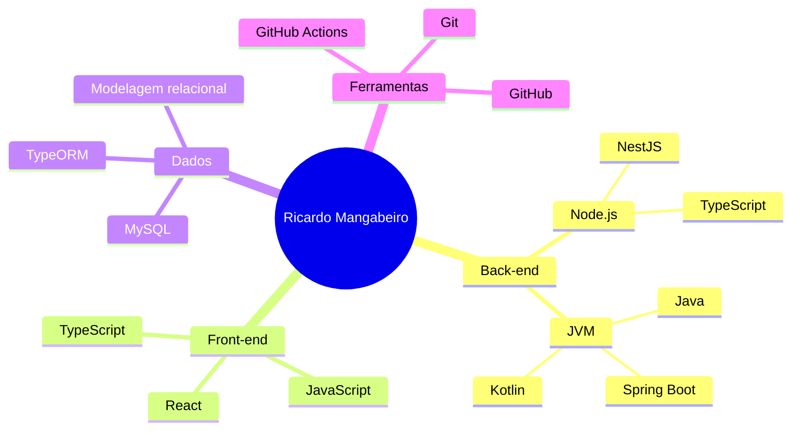
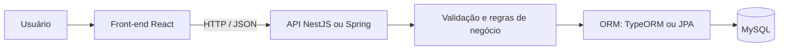

 

---

## 👨‍💻 Sobre mim

Sou desenvolvedor e trabalho dos dois lados da aplicação: no **back-end**, com Node/NestJS e Java/Spring, e no **front-end**, com React. Gosto de API bem organizada, código tipado e banco de dados bem modelado.

---

## 🧰 Tecnologias

  

---

## 🗺️ Mapa mental

### 🔄 Como eu monto uma aplicação

---

## 🐍 Cobrinha das contribuições

<picture>
  <source media="(prefers-color-scheme: dark)" srcset="https://raw.githubusercontent.com/rmvnew/rmvnew/output/github-snake-dark.svg"/>
  <source media="(prefers-color-scheme: light)" srcset="https://raw.githubusercontent.com/rmvnew/rmvnew/output/github-snake.svg"/>
  
</picture>

---

## 📈 Atividade no GitHub

---

  

