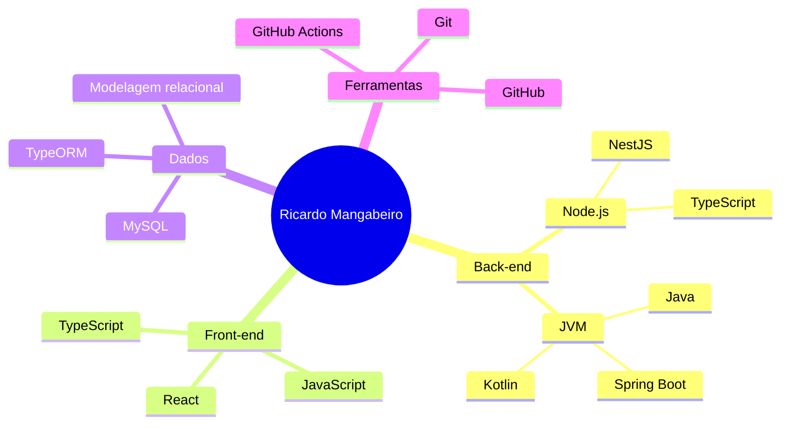
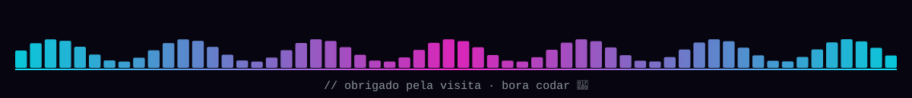

<div align="center">


<picture>
  <source media="(prefers-color-scheme: dark)" srcset="https://raw.githubusercontent.com/rmvnew/rmvnew/output/github-snake-dark.svg"/>
  <source media="(prefers-color-scheme: light)" srcset="https://raw.githubusercontent.com/rmvnew/rmvnew/output/github-snake.svg"/>
  
</picture>

<br/>


<a href="https://github.com/rmvnew?tab=repositories"></a>

</div>

## `> cat sobre-mim.ts`

```ts
const ricardo = {
  nome: "Ricardo Mangabeiro",
  papel: "Desenvolvedor Full Stack",
  backend: ["Node.js", "NestJS", "Java", "Spring Boot", "Kotlin"],
  frontend: ["React", "TypeScript", "JavaScript"],
  dados: ["MySQL", "TypeORM"],
  curte: ["APIs bem organizadas", "código tipado", "banco bem modelado"],
};
```

## `> ls ./stack`

<div align="center">


<br/><br/>


</div>

## `> tree ./mapa-mental`



## `> git log --stats`

<div align="center">


</div>


